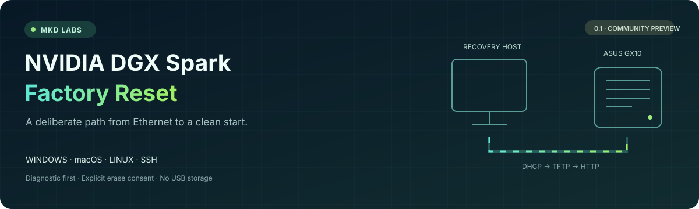
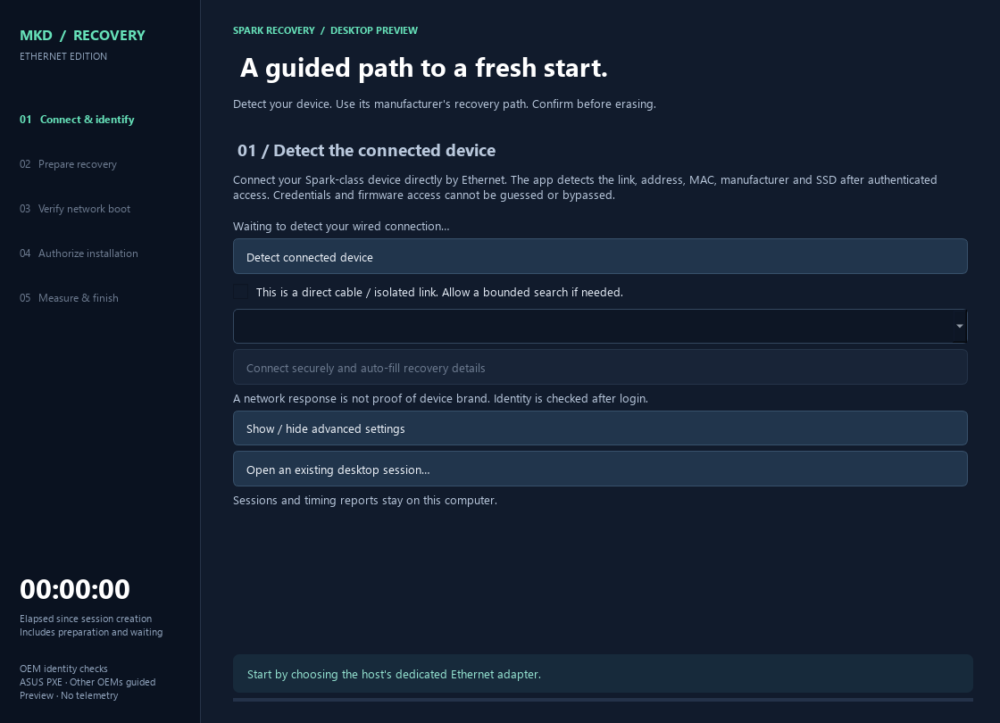

<p align="center"></p>

<p align="center">
<a href="https://github.com/mkd-hossain/nvidia-dgx-spark-factory-reset/actions/workflows/ci.yml"></a>


<a href="LICENSE"></a>
</p>

<p align="center"><strong>No USB storage drive. No default erase. No silent reboot.</strong></p>

Terminal tooling for serving a verified **ASUS Ascent GX10** recovery image over a dedicated Ethernet cable. Prepare on Windows, macOS or Linux; inspect the GX10 locally or over SSH; prove the network boot before exposing an SSD-erasing installation menu.

**Community preview, not an official NVIDIA/ASUS utility.** The original Windows-to-GX10 workflow completed a real reinstall. This packaged implementation is a subsequent rewrite: automated tests do **not** constitute full hardware qualification on every host OS. No tool can guarantee interruption-free recovery. Review [compatibility](docs/COMPATIBILITY.md) before erasing data.

**License:** personal, noncommercial use is free. Commercial/organizational use and redistribution require **MKD's prior written permission**. See [LICENSE](LICENSE). This is source-available, not an OSI open-source license. Dependencies and vendor artifacts retain their own terms.

## Start here

### Desktop app (Windows and Mac)

The **v0.3.0 desktop preview** adds automatic wired-link/device discovery, authenticated auto-fill of MAC/model/SSD/network settings, cached image preparation, specific network/reboot/erase consents, and a temporary read-only diagnostic observer. Download the Windows installer or Apple Silicon/Intel Mac disk image from [Releases](https://github.com/mkd-hossain/nvidia-dgx-spark-factory-reset/releases), then follow [Automatic discovery and OEM recovery](docs/AUTOMATION.md). These builds are unsigned previews; full automatic-flow hardware qualification remains outstanding. Terminal commands remain available.

**Different brands use different paths.** Dell GB10 is recognized and routed to Dell's own recovery instructions. Its Ethernet erase adapter is **not yet qualified**; ASUS media is never substituted. Authentication, firmware restrictions, final console erase confirmation and first-boot observation cannot be silently bypassed.

Timing separates preparation, the recovery session and the operator-observed installation interval. First boot must be confirmed at the target console; download completion never counts as reset success.



| I want to… | Guide |
|---|---|
| Prepare from Windows | [Windows terminal](docs/WINDOWS.md) |
| Use the Windows / Mac desktop app | [Desktop and timing](docs/DESKTOP.md) |
| Prepare from a Mac | [macOS terminal](docs/MACOS.md) |
| Prepare from Linux | [Linux terminal](docs/LINUX.md) |
| Run on the GX10 / control it over SSH | [Target and SSH](docs/TARGET-AND-SSH.md) |
| Follow the full recovery sequence | [Recovery runbook](docs/RECOVERY.md) |
| Report a problem or validate hardware | [Contributing](CONTRIBUTING.md) |
| Request commercial/redistribution permission | [MKD permission request](https://github.com/mkd-hossain/nvidia-dgx-spark-factory-reset/issues/new?template=permission.yml) |

## Compatibility at a glance

| Component | This release |
|---|---|
| Target profile | **ASUS Ascent GX10; ASUS DGX OS 7.5.0-4 ARM64 ISO** |
| Host software | Python 3.11+; Windows/macOS/Linux adapters and CI |
| Transport | UEFI PXE IPv4 → ARM64 GRUB → TFTP boot files → HTTP ISO |
| Target-local commands | Read-only inventory; explicit one-time PXE BootNext/reboot |
| Remote commands | Existing SSH with strict host-key checks; optional noninteractive sudo |
| Founders Edition / other OEM media | **Not supported. Do not substitute ASUS media.** |
| Recover a GX10 using only itself | **Not supported: a separate Ethernet recovery host is required.** |
| Fully unattended / console-free erase | **Not supported: console confirmation is required.** |

NVIDIA's [PXE reference](https://docs.nvidia.com/dgx/dgx-spark/pxe.html) and [Founders Edition recovery procedure](https://docs.nvidia.com/dgx/dgx-spark/system-recovery.html) use different media. ASUS's [official procedure](https://www.asus.com/uk/support/faq/1057440/) documents USB recovery. This project adapts the verified ASUS ISO's Casper HTTP-loading path; it does not imply ASUS endorses this arrangement.

## Quick start

Install Git and Python 3.11+ first. Review the source before granting administrator rights.

```sh
git clone https://github.com/mkd-hossain/nvidia-dgx-spark-factory-reset.git
cd nvidia-dgx-spark-factory-reset
```

**Windows PowerShell:**

```powershell
.\run.ps1 wizard
.\run.ps1 prepare --download
```

**macOS / Linux:**

```sh
sh run.sh wizard
sh run.sh prepare --download
```

The wizard asks for the Ethernet interface, server/client IPv4 addresses and target MAC. It **does not reboot or erase anything**. Preparation downloads about 10 GB directly from ASUS and a small ARM64 bootloader from Canonical, then checks pinned SHA-256 hashes. Allow at least 24 GiB free disk space and preferably 16 GiB host RAM for image inspection. No vendor image, firmware or bootloader binary is redistributed here.

Next, follow the [runbook](docs/RECOVERY.md): collect target inventory, start the services with OS-appropriate privileges, and perform the diagnostic boot. **Do not skip directly to `enable-install`.**

A fully specified plan uses your own interface and MAC (values below are examples):

```sh
python -m spark_recovery --state state init \
  --server 172.31.250.1 --client 172.31.250.2 \
  --interface en5 --mac 02:00:00:00:00:01
```

After launcher setup, use `.venv/bin/python` on Unix or `.venv\Scripts\python.exe` on Windows. Windows uses a **numeric interface index**, not `en5`.

## The recovery contract

```mermaid
flowchart LR
    A[Inspect host and target] --> B[Verify vendor hashes]
    B --> C[Serve dedicated Ethernet]
    C --> D[Diagnostic boot: SSD hidden]
    D --> E[Verify ISO and OEM files]
    E --> F[Match MAC and SSD serial]
    F --> G[Explicit erase authorization]
    G --> H[Cancel-first console confirmation]
    H --> I[Install ASUS OS]
    I --> J[Revoke erase and restore networking]
```



- Only the target MAC receives DHCP, including the recovery kernel's follow-up request. Replies use `255.255.255.255` on the explicit Ethernet interface.
- HTTP serves an explicit file allowlist. TFTP rejects uploads and traversal, supports retries, and handles block-number rollover.
- Manual mode defaults to **STOP**, indefinitely. Automatic mode may start **VERIFY ONLY** after a countdown; it blocks NVMe and stops before installer startup. Erasing installation always retains explicit approval and a cancel-first console menu.
- Erase needs a diagnostic attestation, matching target/disk serial, an exact confirmation phrase and another console selection.
- Managed network changes are journaled; Ctrl+C restores them. After a crash, use `restore`. OS locks prevent competing processes using the same state.
- SSH never disables host-key checks or collects passwords. State contains hardware identifiers and must remain private.

The diagnostic attestation is an **operator statement**, not a certified remote proof. It cannot certify the remaining disk-installation phase. See [security](SECURITY.md) and [architecture](docs/ARCHITECTURE.md).

## Commands

| Command | Behavior |
|---|---|
| `wizard` / `init` | Create a plan; no host changes |
| `prepare --download` | Verify and inspect pinned official artifacts |
| `prepare --iso PATH --bootloader PATH` | Use matching local artifacts |
| `inspect-target --ssh USER@HOST` | Record read-only target inventory |
| `inspect-target --file PATH` | Import target-local inventory JSON |
| `doctor` | Read-only image, port and IP checks |
| `serve --manage-network` | Serve until Ctrl+C; journal temporary host changes |
| `attest-diagnostic --confirm "VERIFIED MAC"` | Record completed operator checks |
| `enable-install --disk DISK --serial SERIAL --confirm "ERASE MAC SERIAL"` | Expose the erase submenu |
| `revoke-install` | Remove erase menu; does not stop a running installer |
| `restore` | Restore host networking after services stop |
| `target --json` | Linux target-local inventory |
| `target --mac MAC --apply [--reboot]` | Explicit one-time target PXE selection/reboot |
| `ssh-boot --ssh USER@HOST --apply [--reboot]` | Same over existing SSH; needs noninteractive sudo |

## Development

```sh
python -m venv .venv
python -m pip install -e ".[test]"
python -m pytest
python -m ruff check src tests
python -m build
```

Use the environment's Python (`.venv/bin/python` or `.venv\Scripts\python.exe`). CI runs Windows, macOS and Linux on Python 3.11/3.12. Tests use loopback/high ports and fixtures: they **never flash hardware, bind privileged DHCP ports, or change real host networks**. [Validation details](docs/VALIDATION.md) distinguish automated tests from hardware evidence.

## Official MKD repositories

- Primary: [mkd-hossain/nvidia-dgx-spark-factory-reset](https://github.com/mkd-hossain/nvidia-dgx-spark-factory-reset)

Neither is an official NVIDIA/ASUS project. Names and marks belong to their respective owners.
