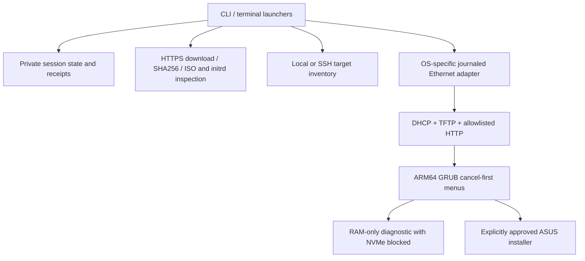

# Architecture

## Scope and assumptions

One operator, one dedicated Ethernet link, one explicitly identified target MAC, one pinned ASUS image, and one recovery session per state directory. The host may be Windows, macOS or Linux. Image preparation is read-only with respect to hardware. Only the GX10 installer writes its SSD after the operator approves both host-side consent and console confirmation.

## Components

`config.py` validates addresses, target MAC, interface values and session identity. `images.py` fetches official artifacts, checks pinned hashes, extracts only selected archive members to fixed destinations, reads the ISO without mounting it and verifies diagnostic initrd properties. It never runs archive contents.

`dhcp.py` accepts only this target's MAC. It offers the ARM64 boot filename only to ARM64 PXE clients while also providing ordinary DHCP leases for the follow-up recovery kernel. Broadcasts use `255.255.255.255`, with the selected interface explicitly bound for Windows, Darwin and Linux. Wildcard UDP 67 is necessary for addressless initial requests; it is exclusive, target-filtered, and must be used only on an isolated link.

`tftp.py` implements read-only octet-mode transfers with bounded sessions/retries, option negotiation, a conservative 1468-byte block cap, and 16-bit block-number rollover. It uses Python sockets, not a POSIX-only file-lock dependency. `server.py` exposes exactly `/recovery.iso` from the verified manifest to the configured target IP/host IP. Directory listing, arbitrary file serving and uploads are absent.

`network.py` is the platform boundary: Windows uses scoped PowerShell commands and session-specific firewall rules; macOS uses an IPv4 alias; Linux uses `ip address add/del`. The journal is written before mutations. Cleanup runs on normal termination, initialization failure and Ctrl+C. `restore` is an explicit crash-recovery action. A file lock prevents another server/preparation/restore command from operating on that same active state.

`target.py` is also a standalone standard-library script. It records hardware/SSD identity and optionally selects the unique IPv4 PXE entry matching the NIC MAC. `cli.py` can transmit that script through existing SSH without installing an agent. Reboot is separate and explicit. No inventory field is executed as a shell command.

## State and consent

`session.json` binds host address, target address/MAC, profile, interface and a random session identifier. `image.json` records verified image/boot artifacts and detected guards. `target.json` contains operator-reviewed hardware/SSD identity. A diagnostic receipt binds the operator's three checks to that exact session/image. An install receipt adds the specific whole NVMe namespace and serial. Menu output must exactly match the renderer and consent receipt before serving.

These files are private local operator state, not a cryptographic attestation service. An administrator who rewrites the program/state can bypass local checks; protection against a malicious administrator is not claimed. Physical target verification and a separate backup remain necessary.

## Trade-offs

- Restricting the initial release to the verified ASUS profile avoids falsely treating different OEM firmware/media as interchangeable.
- A separate recovery host and console confirmation require more operator involvement but preserve a reviewable stop before erase.
- A custom small TFTP server removes the Windows `fcntl` incompatibility encountered in the reference workflow. This creates a protocol maintenance responsibility, covered by loss/rollover/path tests and limited scope.
- Native OS adapters avoid WSL/VM dependencies. Managed macOS/PF/Linux firewall policies still require administrator-specific scoped rules rather than globally disabling firewalls.
- Checksums pin mutable official URLs. If an upstream artifact changes, the tool refuses it; a maintainer must verify and release a reviewed profile update.

Revisit additional OEMs, signed bootloader trust, hardware-backed target identity, firmware-console automation, and multi-target deployment only as separate designs with actual qualification evidence.
