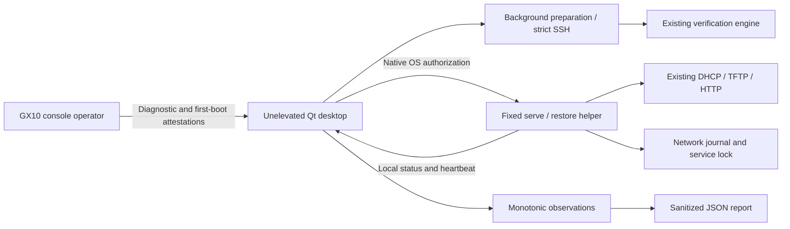

# Desktop architecture

The optional PySide6 Widgets frontend calls the existing Session, prepare, safety and inventory APIs. Terminal entry points and erase guards remain intact. Preparation adds an optional progress callback; default CLI behavior stays the same.

The GUI stays unelevated. Only the fixed serve/restore helper requests native OS authorization. It accepts no arbitrary shell fragment or target-disk operation. Unix arguments are shell-quoted before the macOS authorization call; Windows uses native argument quoting. Install the app into a trusted location before granting privileges. Source-mode elevation is intended for maintainers.

The local session owner is trusted, matching the CLI boundary. Local status is not authenticated proof of SSD progress. DHCP/transfer allowlists are not a defense against a hostile shared LAN. Host mutations use the existing journal and service lock. Failure cleanup runs through the existing code path.

Long preparation and bounded SSH calls run on QThread; Qt signals update the UI. No SSH password or automatic host-key trust is added. Download percentages are byte-based; hashing and target disk installation get no invented percentage. A GUI crash leaves the separate helper serving rather than automatically interrupting an installer. Reopening the app marks continuous timing interrupted.

Timing records monotonic boundaries and contextual UTC, labels operator observations and exports no target identifiers. HTTP 200, PXE traffic and pings are never interpreted as successful installation.

Onedir packaging keeps Qt libraries replaceable, with license texts, source pointers and notices. Destination-platform CI smoke-tests frozen apps. Publisher signing, Apple notarization and independent destructive hardware qualification remain required before a production label; no signing identity is fabricated.
