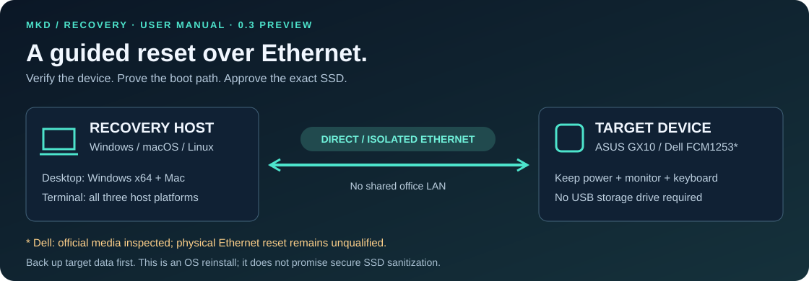
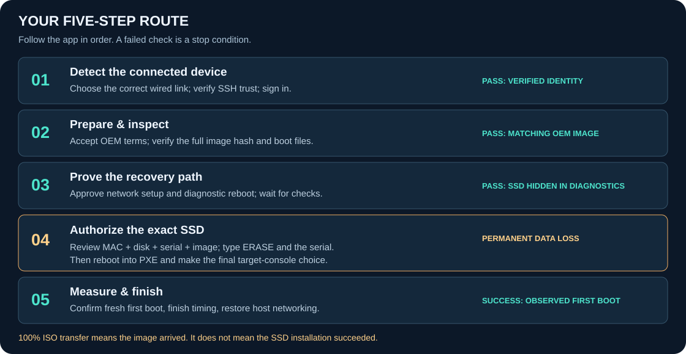
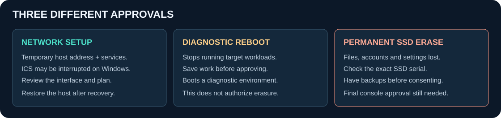

# Visual user manual

**MKD Spark Recovery · v0.3.0 Preview** · [Download the app](https://github.com/mkd-hossain/nvidia-dgx-spark-factory-reset/releases/tag/v0.3.0-preview) · [Second repository](https://github.com/hossain0707/nvidia-dgx-spark-factory-reset/releases/tag/v0.3.0-preview)

[Before you start](#before-you-start) · [Install](#install-the-app) · [Five stages](#follow-the-five-stages) · [Consent](#understand-the-consent) · [Troubleshooting](#when-something-looks-wrong) · [Terminal guides](#terminal-and-ssh-users)

## Before you start

| Bring | Check |
|---|---|
| Recovery computer | Windows x64, Apple Silicon Mac or Intel Mac for the desktop app. Linux uses the terminal tooling. |
| Direct Ethernet cable | Use an isolated link. If the host has several wired adapters, identify the one attached to the target. |
| Target monitor + working keyboard | Needed for firmware access and final installation confirmation. A compatible USB-C adapter/hub for input is fine. |
| Stable power + storage | Keep both machines powered and the host awake. Have at least **24 GiB free** for preparation. |
| Backup + target login | Copy important target data elsewhere. The automatic path needs working SSH and valid credentials. |
| Matching manufacturer/model | ASUS GX10 uses ASUS media. Dell **FCM1253** uses Dell WW/US media; choose the device's correct region. |

> **Preview boundary:** the original Windows/ASUS reference reset succeeded. The new automation still needs hardware qualification. Dell media was inspected offline; a physical Dell Ethernet reset has not been completed. Founders Edition, HP, Lenovo and MSI are not enabled for ASUS/Dell installation. Read [compatibility](COMPATIBILITY.md) and [Dell evidence](DELL.md).

## Install the app

| Your computer | Download from the release | Open it |
|---|---|---|
| Windows x64 | `MKD-Spark-Recovery-0.3.0-Windows-x64-Setup.exe` | Run the installer, then launch **MKD Spark Recovery**. |
| Apple Silicon Mac | `MKD-Spark-Recovery-0.3.0-macOS-arm64.dmg` | Open the DMG and drag the app to **Applications**. |
| Intel Mac | `MKD-Spark-Recovery-0.3.0-macOS-x64.dmg` | Open the DMG and drag the app to **Applications**. |

Compare the downloaded file's SHA-256 with the matching release `SHA256SUMS-*.txt`. Windows: `Get-FileHash <download> -Algorithm SHA256`. Mac: `shasum -a 256 <download>`; replace `<download>` with the file path. These builds are unsigned and not Apple-notarized. Use the OS's supported approval interface after checking origin and hash; do not disable security controls globally. Desktop installers include Python and the SSH client.

## Follow the five stages

### 01 · Detect the connected device

*Illustrative app screenshot. Labels and visible controls can vary with platform and workflow; follow the current stage title.*

1. Connect the Ethernet cable directly between the host and target. Keep the target's monitor and keyboard attached.
2. Open the app. If necessary, click **Detect connected device**. Select the correct adapter/endpoint if more than one is found.
3. Only on a direct or isolated link, enable **Allow a bounded search if needed** when passive discovery finds nothing.
4. Click **Connect securely and auto-fill recovery details** if prompted. Verify a new SSH fingerprint at the physical target before trusting it. A changed fingerprint requires separate review.
5. Sign in with the target account/password or an existing SSH key. The app then reads manufacturer/model, MAC and SSD details and fills the network plan.

**Check before continuing:** the detected model belongs to your device. A network response or familiar IP alone is not identity proof. For Dell, verify the matching WW/US recovery region from the device's support record; the host's location cannot decide it. Cancel if uncertain.

### 02 · Prepare & inspect

| You do | The app does | Ready when |
|---|---|---|
| Accept vendor terms and confirm free space. Leave the ISO field empty to download, or select the exact matching OEM ISO. | Reuses matching cached media or downloads the pinned artifact; checks full SHA-256, boot files and diagnostic guards. | Image verification succeeds and matching target inventory is available. |

In the automatic flow, accepting the terms can start preparation. Otherwise click **Verify and prepare recovery image**. Hashing reads the entire image and can take time without a percentage. An arbitrary ISO with a familiar filename is not accepted.

The SSH textbox and **Import target inventory JSON** are manual alternatives. If the automatic path already collected inventory, do not repeat those steps. See [target-local inventory](TARGET-AND-SSH.md) if SSH is unavailable.

### 03 · Prove the recovery path

1. Review and approve the temporary host-network plan and native administrator prompt. Approve Windows ICS interruption only if it is needed and understood.
2. Wait for **services ready**. Review the separate target reboot consent; save target work before approving.
3. Watch the target boot through **UEFI PXE IPv4**. Firmware or Secure Boot restrictions may require local attention.
4. The observer-enabled diagnostic menu can start **VERIFY ONLY** after five seconds. Installation is not authorized. Wait for the app's read-only diagnostic checks to pass.

If automatic reporting is unavailable, use **Show manual diagnostic fallback** and run these commands **one at a time on the target** at `(initramfs)`:

| Command | Required observation |
|---|---|
| `mount \| grep /cdrom` | `/cdrom` is ISO9660 and includes `ro`. |
| `ls /cdrom/oemdata` | `oem-iso-cfg.sh` and `debs` are present. |
| `ls /dev/nvme*` | No such file or directory: NVMe is intentionally hidden. |

The pipe in the first command is a single `|` character. Record manual checks only after seeing their actual results. **Do not type `exit` to start installation.** Failed or missing checks must be investigated before proceeding.

### 04 · Authorize the exact SSD

> **This stage permits permanent data loss.** Confirm backups, the target MAC, whole SSD path, serial and selected OEM image. The app cannot undo an erase.

1. Choose the inspected SSD. If several are listed, identify the correct physical drive rather than guessing.
2. Click **Enable cancel-first erase menu**. Read the consent dialog, acknowledge the consequences and type `ERASE` followed by the exact SSD serial when requested.
3. After authorization, return the target to PXE. From the deliberate diagnostic shell, `reboot -f` is appropriate **only when no installer is running**; select the matching UEFI PXE IPv4 entry again. If it returns to the existing OS, use the [one-time BootNext instructions](TARGET-AND-SSH.md).
4. At the target menu, select **ERASE SSD**, then **CONFIRM ERASE … START INSTALLATION**. STOP/CANCEL remains the safe default. This final console selection starts the destructive installation.
5. Immediately click **I selected CONFIRM ERASE — start installation timer** in the app to record the observed interval.

Keep power, Ethernet and host services running throughout installation. A quiet screen is not permission to restart either computer.

### 05 · Measure & finish

1. Wait for the installer to finish and the target to reach fresh first-run setup or its new desktop. **100% image transfer is not installation success.**
2. Confirm that first boot in the app. The automatic flow removes future erase authorization and requests host-service cleanup.
3. Verify services have stopped and host networking has been restored. Use **Stop services & restore host networking** if cleanup still needs to be requested.
4. Click **Export timing report**. Finish normal target setup, then reconnect SSH/NVIDIA Sync using the new account and verified host key. The old IP address is not guaranteed.

| Clock | What it measures |
|---|---|
| Sidebar elapsed | Time since session creation, including preparation and waiting. |
| Preparation | Download, verification and preparation interval, including waiting/retries. |
| Recovery session | Services ready until operator-confirmed first boot. |
| Observed installation | Your final console selection marker until confirmed first boot; includes operator reaction time. |

Reports are local, sanitized exports with operator-confirmed completion. Reopening an interrupted run does not reconstruct a continuous benchmark. See [timing details](DESKTOP.md#timing-boundaries).

## Understand the consent

Approving one stage does not approve the next. Cancel when the device, interface, region, SSD serial or consequences are unclear. Removing an erase option affects future boots; it cannot stop or undo an installer already writing the disk.

## When something looks wrong

| What you see | What to do next |
|---|---|
| No device found | Check power, cable, selected wired link and whether SSH is enabled. Use the target console if addressing or login is not configured. Do not enter guessed MACs or credentials. |
| Changed SSH key | A reinstall can change keys. Compare the fingerprint on the actual target; approve replacement only after verification. |
| ISO picker shows no files | Cancel to download automatically, or navigate to an already downloaded matching `.iso`. The app installation directory does not include vendor media. |
| Checksum/OEM/region mismatch | Stop. Recheck the exact profile and download; do not rename a different ISO or bypass verification. |
| PXE returns to the existing desktop | Network boot did not reach recovery. Check service readiness, the correct PXE entry and firmware settings. No reset success should be inferred. |
| `(initramfs)` prompt | Expected in diagnostic mode. Check the observations above; do not exit the shell to install. |
| Lost heartbeat or frozen display | Inspect the target console. Do not force-reboot a potentially writing installer. Preserve the error details. |
| App/helper crashed | Reopen the existing session. Restore networking only after confirming the helper is stopped and no installer depends on it. Keep the session journal. |

Share sanitized timing reports and reviewed/redacted error details when [reporting a problem](https://github.com/mkd-hossain/nvidia-dgx-spark-factory-reset/issues). Session folders can contain MACs, serials, addresses and paths; do not publish them wholesale.

## Terminal and SSH users

| Workflow | Detailed guide |
|---|---|
| Windows PowerShell host | [Windows](WINDOWS.md) |
| macOS terminal host | [macOS](MACOS.md) |
| Linux terminal host | [Linux](LINUX.md) |
| Local target inspection / remote SSH control | [Target and SSH](TARGET-AND-SSH.md) |
| ASUS reference diagnostic/install sequence | [Recovery runbook](RECOVERY.md) |
| Dell-specific profiles and qualification limits | [Dell](DELL.md) |

Dell CLI users must create a session with `--profile dell-fcm1253-ota3-ww` or `--profile dell-fcm1253-ota3-us` and their own correct network arguments. The legacy interactive wizard defaults to ASUS. A separate recovery host remains required; running a target inspection command does not make the device able to serve its own reset.

---

Personal noncommercial use is free under the [MKD license](../LICENSE). Commercial/organizational use and redistribution require prior written permission. This community project is not an official NVIDIA, ASUS or Dell utility.
